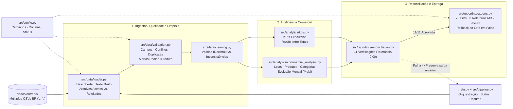

# Sales Automation Engine V2

Solução modular em **Python**, **Pandas** e **Pytest** para automação do processamento de arquivos comerciais de vendas em formato brasileiro, com validação rigorosa de qualidade de dados, precisão monetária em `Decimal`, reconciliação matemática obrigatória (`11` verificações) e exportação pronta para consumo no Power BI.

> **Aviso de escopo:** Este é um projeto **demonstrativo e educacional de portfólio**, desenvolvido em ambiente local sobre dados fictícios e sintéticos. Ele **não** foi utilizado por uma empresa real e **não** reivindica economia de tempo, redução de custos ou retorno financeiro.

---

## 1. Problema Empresarial e Objetivo

Em rotinas comerciais, receber múltiplos arquivos CSV de vendas com datas impossíveis, campos ausentes, valores negativos ou malformados, arquivos vazios e registros duplicados torna o fechamento manual lento e suscetível a erros silenciosos.

**Objetivo da V2:** Evoluir meu script linear inicial da V1 (`main.py` único com 3 caminhos fixos) para uma arquitetura procedural modular, auditável e reproduzível que automatize de ponta a ponta:

1. Descoberta dinâmica e validação estrutural de múltiplos arquivos CSV;
2. Validação detalhada de qualidade de dados preservando integralmente os valores originais rejeitados;
3. Consolidação de vendas válidas com cálculo monetário exato em `Decimal` (sem conversão intermediária para `float`);
4. Cálculo de KPIs executivos e análises comerciais (lojas, produtos, categorias e evolução mensal);
5. Reconciliação matemática independente antes de liberar qualquer arquivo de saída;
6. Exportação segura de 7 CSVs para Power BI, 3 relatórios Markdown e 1 resumo estruturado em JSON (substituição atômica individual por arquivo + rollback em melhor esforço do lote em caso de erro).

---

## 2. Resultados Verificados (Base Original V1 Preservada)

Executando `python main.py` sobre os 3 CSVs originais preservados em `dados/entrada/` (`vendas_janeiro.csv`, `vendas_fevereiro.csv`, `vendas_marco.csv`), a V2 reproduz **100% dos indicadores históricos da V1** e elimina completamente o ruído de ponto flutuante (`float64`) observado nos CSVs da V1:

| Indicador | Baseline V1 | Resultado V2 Verificado | Reconciliação |
| --- | ---: | ---: | --- |
| Arquivos encontrados / aceitos / rejeitados | 3 fixos | **3 / 3 / 0** (`SUCESSO`) | `REC-01` (`0` dif.) |
| Total de registros recebidos | 42 | **42** (`36` válidos + `6` rejeitados) | `REC-02` (`0` dif.) |
| Registros de vendas válidos | 36 | **36** | Aprovado |
| Inconsistências (taxa de rejeição) | 6 | **6 (`14,29%`)** | Aprovado |
| Pedidos distintos | 36 | **36** | `REC-09` (`0` dif.) |
| Unidades vendidas | 120 | **120** | `REC-08` (`0` dif.) |
| Faturamento total | R$ 65.068,00 | **R$ 65.068,00** (`Decimal` exato) | `REC-03..07` (`0,00`) |
| Ticket médio por pedido | R$ 1.807,44 | **R$ 1.807,44** (`65.068,00 / 36`) | `REC-11` (`0,00`) |
| Receita por unidade | — | **R$ 542,23** (`65.068,00 / 120`) | `REC-11` (`0,00`) |
| Linhas com ruído `float64` eliminadas | 5 linhas | **0 linhas** (`Decimal` direto da string) | Auditado |

### Principais Achados Comerciais na Base Demonstrativa (`2026-01` a `2026-03`)

- **Lojas:** `Centro` liderou com **R$ 24.997,90** (`38,42%`, ticket médio `R$ 2.777,54`), seguida por `Online` (`R$ 18.826,80`, `28,93%`), `Norte` (`R$ 11.626,40`, `17,87%`) e `Sul` (`R$ 9.616,90`, `14,78%`).
- **Categorias e Produtos:** `Informática` concentrou **39,34%** do faturamento (`R$ 25.598,60`), impulsionada por `Notebook Pro 14` (`R$ 17.499,50`, `26,89%`) e `Monitor 24` (`R$ 8.099,10`, `12,45%`).
- **Evolução Mensal:** o faturamento cresceu de **R$ 14.547,10** em `2026-01` para **R$ 22.676,10** em `2026-02` (`+55,88%`) e **R$ 27.844,80** em `2026-03` (`+22,79%`; acumulado `+91,41%`), acompanhando a expansão de `29 -> 39 -> 52` unidades vendidas.

*(Não há cálculo de lucro ou margem porque os dados de entrada não possuem custos.)*

---

## 3. Arquitetura e Fluxo de Processamento



### Principais Funcionalidades Implementadas

- **Ingestão dinâmica e defensiva:** lê qualquer quantidade de CSVs em ordem determinística usando `dtype=str, keep_default_na=False`, inspeciona o cabeçalho bruto (`header=None, nrows=1`) rejeitando colunas duplicadas/ambíguas ou vazias, rejeita arquivos vazios (0 bytes ou apenas cabeçalho), malformados, com codificação inválida, com deslocamento silencioso de colunas ou sem colunas obrigatórias, e registra `Arquivo de origem` e `Linha no arquivo`.
- **Qualidade de dados sem mascaramento:** acumula **todos** os problemas de uma mesma linha sem contá-la duas vezes na reconciliação; valida formato numérico brasileiro estrito (rejeitando `12.34`, `1,5` em quantidade, `inf`, `-Infinity`, `NaN`); preserva inteiros exatos em `dtype="object"` sem coerção silenciosa para `float64`; rejeita todas as linhas de pedidos com `Data` ou `Loja` conflitantes entre arquivos; preserva a política de duplicatas exatas da V1; e destaca ocorrências válidas de mesmo `Pedido + Produto` com atributos distintos como **alertas de investigação**.
- **Precisão monetária em `Decimal`:** valores monetários construídos diretamente da string normalizada (zero `float` intermediário).
- **Status honesto em execução parcial:** quando existe qualquer arquivo rejeitado, a execução recebe status `CONCLUIDO_PARCIALMENTE` (jamais `SUCESSO` integral).
- **Proteção de saída e idempotência:** erros bloqueantes ou falha de reconciliação encerram com código `1` sem sobrescrever relatórios válidos anteriores; falhas durante a gravação acionam rollback em melhor esforço do lote para evitar mistura entre execuções (cada arquivo individual é gravado via `.tmp -> replace()`); reexecuções sobre os mesmos dados geram resultados idênticos sem duplicação artificial.

---

## 4. Captura Real da Execução e Saída Verificada

### Execução Real no Terminal (`python main.py`)
```text
====================================================================
SALES AUTOMATION ENGINE V2 — RESUMO DA EXECUÇÃO
====================================================================
Data/hora:              26/11/2026 01:30:12
Status da execução:     SUCESSO
Resultado:              Processamento integral concluído e reconciliado.
--------------------------------------------------------------------
Arquivos encontrados:   3 (aceitos: 3 | rejeitados: 0)
--------------------------------------------------------------------
Registros recebidos:    42 (apenas arquivos aceitos)
Vendas válidas:         36
Inconsistências:        6 (14,29%)
Pedidos distintos:      36
Unidades vendidas:      120
Faturamento total:      R$ 65.068,00
Ticket médio/pedido:    R$ 1.807,44
Receita por unidade:    R$ 542,23
--------------------------------------------------------------------
Reconciliação:          APROVADA (11/11 verificações)
Alertas investigação:   0 (Pedido + Produto recorrente)
Tempo de execução:      0.0579 s
Arquivos gerados:       11
====================================================================
```

### Suíte de testes e teste de volume
A suíte atual possui **46 testes**; o benchmark usa volumes sintéticos de 1.000, 10.000 e 100.000 registros.

---

## 5. Exemplos de Entrada, Saída, Qualidade e Reconciliação

### Exemplo de Entrada (`dados/entrada/vendas_janeiro.csv`)
```csv
Data;Pedido;Loja;Produto;Categoria;Quantidade;Preço Unitário
05/01/2026;P-1001;Centro;Notebook Pro 14;Informática;1;3.499,90
06/01/2026;P-1002;Online;Mouse Sem Fio;Acessórios;3;89,90
31/01/2026;P-1013;;Teclado Mecânico;Acessórios;1;249,90
```

### Exemplo de Saída Tratada (`resultado/vendas_tratadas.csv`)
```csv
Data;Ano_Mes;Pedido;Loja;Produto;Categoria;Quantidade;Preço Unitário;Faturamento;Arquivo de origem;Linha no arquivo
05/01/2026;2026-01;P-1001;Centro;Notebook Pro 14;Informática;1;3499,90;3499,90;vendas_janeiro.csv;2
06/01/2026;2026-01;P-1002;Online;Mouse Sem Fio;Acessórios;3;89,90;269,70;vendas_janeiro.csv;3
```

### Exemplo de Inconsistência Preservada (`resultado/inconsistencias.csv`)
```csv
Data;Pedido;Loja;Produto;Categoria;Quantidade;Preço Unitário;Arquivo de origem;Linha no arquivo;Quantidade de problemas;Motivo;Status
31/02/2026;P-3013;Centro;Monitor 24;Informática;1;899,90;vendas_marco.csv;14;1;Data inválida;Inválido
```

### Relatórios de Referência Verificados
- [`reports/relatorio_qualidade.md`](reports/relatorio_qualidade.md) — Ingestão, motivos, conflitos de cabeçalho e alertas de investigação
- [`reports/relatorio_reconciliacao.md`](reports/relatorio_reconciliacao.md) — Matriz completa das 11 verificações (`REC-01` a `REC-11`) e auditoria `Decimal` vs. `float64`
- [`reports/relatorio_executivo.md`](reports/relatorio_executivo.md) — KPIs, rankings, evolução mensal e interpretação comercial
- [`reports/resumo_execucao.json`](reports/resumo_execucao.json) — Resumo estruturado JSON da execução
- [`reports/benchmark_volumes.md`](reports/benchmark_volumes.md) — Medições reais em `1.000`, `10.000` e `100.000` registros sintéticos

### Resumo das Medições Reais de Volume (Dados Sintéticos)
Ambiente: Windows 11 Pro (`10.0.26300`), AMD Ryzen 7 5800X3D, 31,92 GB RAM, Python `3.12.7`, `pandas==3.0.3`:

| Volume Sintético | Válidos | Rejeitados (~5%) | Reconciliação | Processamento (s) | Total com Exportação (s) |
| ---: | ---: | ---: | --- | ---: | ---: |
| 1.000 linhas | 950 | 50 | APROVADA (`11/11`) | 0.0734 s | 0.1141 s |
| 10.000 linhas | 9.500 | 500 | APROVADA (`11/11`) | 0.2116 s | 0.3214 s |
| 100.000 linhas | 95.000 | 5.000 | APROVADA (`11/11`) | 1.6686 s | 2.8463 s |

*(Tempos efetivamente medidos para observar comportamento funcional em diferentes escalas — não constituem benchmark industrial.)*

---

## 6. Como Instalar, Executar e Testar (Windows / Linux)

Recomenda-se **Python 3.12**.

### Instalação e Execução no Windows (PowerShell)
```powershell
# 1. Criar e ativar o ambiente virtual limpo
python -m venv .venv
.\.venv\Scripts\Activate.ps1

# 2. Instalar dependências exatas (apenas pandas e pytest)
python -m pip install -r requirements.txt

# 3. Executar o processamento principal (lê dados/entrada/ e gera 11 arquivos em resultado/)
python main.py

# 4. Executar a suíte completa de 46 testes automatizados
python -m pytest -v

# 5. (Opcional) Executar o teste de volumes sintéticos (1k, 10k, 100k)
python scripts/benchmark_volumes.py
```

*(Também é possível executar com um clique pelo atalho `executar_projeto.cmd` após configurar a `.venv`. No Linux/macOS, ative com `source .venv/bin/activate`.)*

---

## 7. Estrutura do Repositório

```text
automacao-relatorio-vendas/
├── main.py                              # Ponto de entrada CLI (coordenação e resumo)
├── executar_projeto.cmd                 # Atalho Windows
├── src/
│   ├── config.py                        # Caminhos, colunas obrigatórias, formato BR e status
│   ├── pipeline.py                      # Orquestração ponta a ponta e status honesto
│   ├── data/
│   │   ├── loader.py                    # Ingestão dinâmica e validação estrutural de CSVs
│   │   ├── validation.py                # Regras de qualidade, Decimal, conflitos, duplicatas e alertas
│   │   └── cleaning.py                  # Separação vendas válidas vs. inconsistências brutas
│   ├── analytics/
│   │   ├── kpis.py                      # KPIs executivos (razão entre totais)
│   │   └── commercial_analysis.py       # Lojas, produtos, categorias e evolução mensal (MoM)
│   └── reporting/
│       ├── reconciliation.py            # 11 verificações matemáticas em Decimal (tolerância 0,00)
│       └── exports.py                   # 7 CSVs, 3 MDs e 1 JSON (rollback do lote em falha)
├── dados/
│   ├── entrada/                         # 3 CSVs originais da V1 preservados intactos (UTF-8, LF)
│   └── exemplos/                        # 8 cenários sintéticos documentados para demonstração
├── resultado/                           # Pasta de saída gerada ao executar `python main.py`
├── reports/                             # Relatórios verificados, benchmark e capturas reais
├── scripts/
│   └── benchmark_volumes.py             # Teste de volumes sintéticos (1k / 10k / 100k)
├── tests/                               # 46 testes automatizados em Pytest
├── legacy/v1/                           # Cópia preservada do `main.py` original da V1
├── docs/                                # Documentação de engenharia, guia de estudo e 20 desafios
├── README.md
├── requirements.txt
├── .gitattributes                       # Preservação canônica de terminação LF
└── .gitignore
```

---

## 8. Documentação de Engenharia e Material de Aprendizagem

- [`docs/ARCHITECTURE.md`](docs/ARCHITECTURE.md) — Arquitetura modular, política de erros e decisões técnicas
- [`docs/DATA_DICTIONARY.md`](docs/DATA_DICTIONARY.md) — Esquema completo de entrada e dos 11 arquivos de saída
- [`docs/DATA_QUALITY.md`](docs/DATA_QUALITY.md) — Barreiras de qualidade, múltiplos erros e achados na base V1
- [`docs/BUSINESS_RULES.md`](docs/BUSINESS_RULES.md) — Granularidade, conflitos, duplicatas, fórmulas e reconciliação

---

## 9. Limitações Conhecidas

1. **Ausência de identificador único de linha (`ID_Item`):** impede provar de forma absoluta se duas linhas integralmente idênticas são duplicatas técnicas ou compras repetidas no mesmo pedido; a remoção de duplicatas exatas é uma regra adotada para este conjunto, enquanto `Pedido + Produto` com atributos distintos gera alerta de investigação.
2. **Premissa de unicidade global de `Pedido`:** assume-se que um mesmo código de pedido não é reutilizado entre lojas ou datas diferentes.
3. **Sem cadastro mestre ou dados de custo:** não valida erros de grafia em nomes de produtos/lojas contra uma tabela dimensão externa e não calcula lucro ou margem.
4. **Processamento local em memória:** adequado para demonstração e lotes locais de até dezenas/centenas de milhares de registros, sem banco de dados, agendador ou processamento distribuído.

---

## 10. Minha Contribuição e Assistência de IA

- **Minha participação:** Desenvolvi originalmente a versão V1 deste projeto (`legacy/v1/main_v1.py` e `dados/entrada/`), definindo a rotina de leitura dos CSVs brasileiros, regras iniciais de validação e indicadores comerciais. Na evolução V2, defini os requisitos empresariais, as regras de conflito de cabeçalho, a política de alertas para `Pedido + Produto`, a exigência de `Decimal` direto a partir de strings normalizadas e as restrições de escopo compatíveis com meu estágio atual, autorizando explicitamente apenas o conjunto mínimo de recursos adicionais da biblioteca padrão, Pandas e Pytest.
- **Assistência de IA:** Utilizei assistência de IA como mentoria técnica para auditar a V1, estruturar a arquitetura modular em `src/`, implementar a reconciliação matemática com tolerância zero, construir a suíte de 46 testes Pytest, executar a verificação de volumes sintéticos e elaborar os guias de estudo, desafios e notas de entrevista. Os conceitos novos ainda estão em consolidação e exigem prática para reconstrução autônoma.

---

## Autor

**Luan Gabriel** · Estudante de Inteligência Artificial e Machine Learning na UNIASSELVI · [GitHub](https://github.com/LuanGabriel12)
