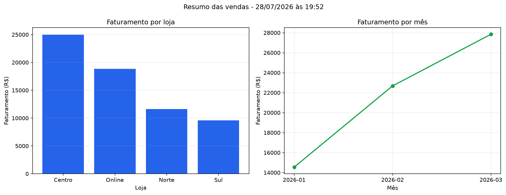

# Análise de vendas com Python

Montei este projeto para praticar análise de dados com uma situação parecida
com uma rotina de empresa. O programa reúne as vendas de três meses, encontra
linhas com problemas, calcula os principais resultados e gera arquivos que
podem ser usados em uma análise.

Mantive todo o código em um único arquivo para conseguir acompanhar a ordem
das etapas e explicar o que cada parte faz. Os dados são fictícios.

## O que o projeto faz

- Lê três arquivos CSV com Pandas;
- Junta os meses em uma única tabela;
- Identifica dados ausentes, datas inválidas e vendas duplicadas;
- Calcula faturamento, ticket médio e quantidade de itens;
- Cria análises por loja, produto e mês;
- Salva cinco tabelas em CSV;
- Gera um gráfico em PNG com Matplotlib.

## Tecnologias utilizadas

- Python;
- Pandas;
- NumPy;
- Matplotlib;
- `datetime`, que já faz parte do Python.

## Resultado com os dados de exemplo

| Indicador | Resultado |
|---|---:|
| Vendas válidas | 36 |
| Inconsistências | 6 |
| Pedidos | 36 |
| Itens vendidos | 120 |
| Faturamento | R$ 65.068,00 |
| Ticket médio | R$ 1.807,44 |



## Como executar

É necessário ter o Python 3.10 ou mais recente instalado.

No Windows, abra o PowerShell dentro da pasta do projeto e execute:

```powershell
python -m venv .venv
.\.venv\Scripts\python.exe -m pip install -r requirements.txt
.\.venv\Scripts\python.exe main.py
```

Depois da primeira configuração, também é possível executar o arquivo
`executar_projeto.cmd`.

Os resultados serão criados na pasta `resultado`.

## Arquivos gerados

| Arquivo | Conteúdo |
|---|---|
| `vendas_tratadas.csv` | Vendas que passaram pela validação |
| `inconsistencias.csv` | Linhas que precisam ser corrigidas |
| `analise_lojas.csv` | Quantidade e faturamento por loja |
| `analise_produtos.csv` | Quantidade e faturamento por produto |
| `analise_mensal.csv` | Quantidade e faturamento por mês |
| `resumo_vendas.png` | Gráficos de faturamento |

## Estrutura

```text
.
├── dados/
│   └── entrada/              # arquivos CSV usados na análise
├── docs/
│   ├── como_funciona.md      # explicação da lógica
│   └── resumo_vendas.png     # exemplo do gráfico gerado
├── resultado/                # arquivos criados pelo programa
├── executar_projeto.cmd
├── main.py                   # código do projeto
└── requirements.txt
```

## Formato dos dados

Os arquivos de entrada usam `;` como separador e precisam ter estas colunas:

| Coluna | Exemplo |
|---|---|
| Data | 28/03/2026 |
| Pedido | P-3012 |
| Loja | Sul |
| Produto | Mouse Sem Fio |
| Categoria | Acessórios |
| Quantidade | 7 |
| Preço Unitário | 89,90 |

Os arquivos de exemplo possuem cinco linhas incorretas e uma venda repetida de
propósito. Dessa forma, é possível conferir se a limpeza está funcionando.

## O que pratiquei

- `read_csv()` e `concat()` para leitura e união dos dados;
- Tratamento de datas e valores ausentes;
- Filtros com `loc`;
- Cálculos entre colunas;
- `groupby()` para resumir os resultados;
- Criação de gráficos com Matplotlib;
- Exportação de DataFrames para CSV.

A ordem completa das etapas está em
[docs/como_funciona.md](docs/como_funciona.md).

## Limitações atuais

- Os três nomes de arquivo estão escritos no começo do `main.py`;
- Os arquivos precisam ser CSV e usar `;` como separador;
- Os nomes das colunas precisam seguir o modelo deste projeto;
- O programa deve ser executado a partir da pasta do projeto.

Uma próxima versão pode procurar novos arquivos automaticamente e separar o
código em funções. Preferi deixar essas melhorias para depois de dominar esses
conceitos.
