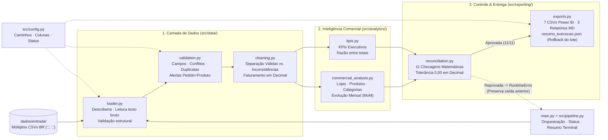

# Arquitetura do Sistema — Sales Automation Engine V2

Este documento descreve a arquitetura procedural modular do **Sales Automation Engine V2**, o fluxo completo dos dados, a responsabilidade de cada módulo, a política explícita de erros e as decisões técnicas adotadas.

---

## 1. Princípios Arquiteturais

1. **Simplicidade deliberada (procedural modular):** nenhuma classe complexa ou padrão arquitetural artificial. O sistema é organizado em funções pequenas, previsíveis e testáveis agrupadas por responsabilidade.
2. **Compatibilidade com o inventário técnico:** construído exclusivamente com **Python**, **Pandas**, **Pytest** e o conjunto mínimo explicitamente autorizado da biblioteca padrão (`pathlib`, `datetime`, `json`, `decimal`, `time.perf_counter`, `sys.exit`). Zero importações diretas de `numpy`, `matplotlib`, `seaborn` ou frameworks externos.
3. **Preservação da verdade bruta:** os arquivos originais em `dados/entrada/` nunca são modificados. Os registros rejeitados preservam seus valores originais exatos em `inconsistencias.csv`.
4. **Precisão monetária e inteira exata:** preços e faturamentos são construídos em `Decimal` diretamente a partir das strings normalizadas (sem `float` intermediário), e quantidades inteiras são mantidas em `dtype="object"` durante validação, limpeza e agregações para impedir coerção silenciosa para `float64` (ex.: inteiros acima de $2^{53}$ misturados com `None`).
5. **Segurança na saída (substituição atômica por arquivo + rollback do lote):** nenhum arquivo em `resultado/` é alterado antes de a reconciliação passar. Durante a exportação, cada arquivo individual é substituído via `.tmp -> replace()` e o lote conta com snapshot prévio e **rollback em melhor esforço (*best-effort rollback*)** em caso de erro no meio da gravação, restaurando o lote anterior para impedir mistura entre execuções (sem alegar transação ACID integral de sistema de arquivos).

---

## 2. Diagrama de Arquitetura e Fluxo dos Dados

---

## 3. Responsabilidade de Cada Módulo

| Módulo | Responsabilidade Principal | Funções-Chave |
| --- | --- | --- |
| `main.py` | Ponto de entrada CLI enxuto; invoca o pipeline, exibe resumo honesto no terminal e retorna código de saída `1` em falha bloqueante. | `exibir_resumo_terminal()`, `main()` |
| `src/config.py` | Fonte única de caminhos portáveis (`Path`), colunas obrigatórias, constantes de formato CSV brasileiro, precisão `Decimal`, nomes dos 11 arquivos de saída e códigos de status. | Constantes de projeto |
| `src/pipeline.py` | Coordena as 6 etapas sequenciais, define o status oficial (incluindo detecção explícita de execução parcial) e impede sobrescrita em falhas. | `determinar_status_execucao()`, `executar_pipeline()` |
| `src/data/loader.py` | Descobre `.csv` em ordem alfabética determinística, valida cabeçalho bruto (`header=None, nrows=1`) contra nomes vazios ou duplicados/ambíguos, lê tudo como texto bruto (`dtype=str, keep_default_na=False`), detecta arquivos vazios/corrompidos/sem colunas obrigatórias/com deslocamento silencioso de colunas e adiciona `Arquivo de origem` e `Linha no arquivo`. | `listar_arquivos_csv()`, `ler_arquivo_csv_individual()`, `carregar_arquivos_entrada()` |
| `src/data/validation.py` | Converte números brasileiros diretamente para `Decimal`/`int`, acumula todos os motivos de erro por linha, rejeita pedidos com `Data`/`Loja` conflitantes, remove duplicatas exatas (política V1) e identifica alertas de investigação `Pedido + Produto`. | `converter_texto_para_decimal_br()`, `converter_quantidade_br()`, `converter_preco_br()`, `validar_vendas()` |
| `src/data/cleaning.py` | Separa `vendas_validas` (normalizadas, tipadas, ordenadas cronologicamente e com `Faturamento` em `Decimal`) de `inconsistencias` (valores brutos originais preservados). | `separar_vendas_e_inconsistencias()` |
| `src/analytics/kpis.py` | Calcula KPIs consolidados com razão entre totais (sem média de médias, sem lucro/margem fictícios, protegido contra divisão por zero). | `arredondar_decimal()`, `calcular_kpis_executivos()`, `construir_tabela_kpis_executivos()` |
| `src/analytics/commercial_analysis.py` | Produz rankings determinísticos por loja, produto e categoria, além da série mensal com comparação período a período (`MoM`). | `analisar_por_loja()`, `analisar_por_produto()`, `analisar_por_categoria()`, `analisar_mensal()`, `gerar_analises_comerciais()` |
| `src/reporting/reconciliation.py` | Executa 11 checagens independentes (registros, faturamento linha a linha e por dimensão, unidades, pedidos, participações e KPIs) com tolerância `0,00` em `Decimal`, além de auditar ruído `float64`. | `executar_reconciliacao()` |
| `src/reporting/exports.py` | Formata números brasileiros e CSVs UTF-8/LF para Power BI, gera os 3 relatórios Markdown e `resumo_execucao.json`, grava cada arquivo individualmente via `.tmp` + `Path.replace()` e aplica snapshot/rollback em melhor esforço do lote em caso de falha parcial. | `exportar_resultados()`, `gerar_relatorio_qualidade_md()`, `gerar_relatorio_reconciliacao_md()`, `gerar_relatorio_executivo_md()`, `gerar_resumo_execucao_dict()` |

---

## 4. Política Explícita de Erros e Status de Execução

| Nível do Problema | Comportamento do Motor | Status / Código de Saída | Efeito na Pasta `resultado/` |
| --- | --- | --- | --- |
| **Bloqueante — Pasta ausente ou sem `.csv`** | Levanta `FileNotFoundError` imediatamente. | `FALHA` (`sys.exit(1)`) | **Preserva** relatórios válidos anteriores intactos. |
| **Bloqueante — Todos os CSVs rejeitados estruturalmente** | Levanta `ValueError` listando todos os arquivos e motivos. | `FALHA` (`sys.exit(1)`) | **Preserva** relatórios válidos anteriores intactos. |
| **Bloqueante — Reconciliação matemática reprovada** | Levanta `RuntimeError` indicando os códigos `REC-*` reprovados. | `FALHA` (`sys.exit(1)`) | **Preserva** relatórios válidos anteriores intactos. |
| **Parcial — 1+ arquivos rejeitados, mas 1+ aceitos** | Processa e reconcilia os arquivos aceitos, exibindo aviso de execução parcial em todos os relatórios e terminal. | `CONCLUIDO_PARCIALMENTE` (ou `CONCLUIDO_PARCIALMENTE_SEM_VENDAS_VALIDAS`) | Atualiza com marcação explícita de execução parcial (nunca `SUCESSO`). |
| **Controlado — Arquivos aceitos, mas 0 vendas válidas** | Calcula KPIs zerados sem `ZeroDivisionError` e reconcilia `recebidos == 0 + rejeitados`. | `CONCLUIDO_SEM_VENDAS_VALIDAS` | Exporta relatórios completos com diagnóstico de 0 vendas. |
| **Integral — Todos os arquivos aceitos, vendas válidas > 0 e reconciliação `11/11`** | Processamento e entrega completos. | `SUCESSO` (exit `0`) | Exportação atômica dos 11 arquivos. |

---

## 5. Decisões Arquiteturais e Trade-offs

1. **Leitura inicial como string (`dtype=str, keep_default_na=False`) + `Decimal` direto:** evita conversão automática silenciosa do Pandas, impede `TypeError` em valores malformados e elimina ruído `float64` (comprovado em 5 linhas e `0.00000000001` no total sobre a própria base V1). O custo em tempo é baixo (`~3,3 s` para `100.000` linhas).
2. **Detecção de deslocamento silencioso de colunas (`isinstance(tabela.index, pd.RangeIndex)`):** no Pandas, quando a primeira linha de dados possui mais delimitadores `;` do que o cabeçalho, o leitor pode empurrar colunas para o `MultiIndex` sem disparar `ParserError`. A verificação explícita do índice bloqueia essa corrupção silenciosa.
3. **Atomicidade por arquivo + rollback do lote em melhor esforço:** cada arquivo individual é substituído via `<arquivo>.tmp -> Path.replace()`, e antes da gravação o lote salva um snapshot dos arquivos já existentes. Caso falhe no meio (ex.: na 2ª gravação), o rollback restaura os arquivos já alterados (ou remove os recém-criados se a pasta estava vazia) e lança `RuntimeError`. Não declaramos atomicidade integral de banco/sistema de arquivos porque falhas físicas de hardware durante o próprio rollback continuam possíveis em disco local — e, se ocorrerem, são reportadas explicitamente no erro.
4. **Preservação de `legacy/v1/main_v1.py`:** mantém rastreabilidade histórica da V1 sem contaminar os módulos produtivos nem os requisitos da V2.
